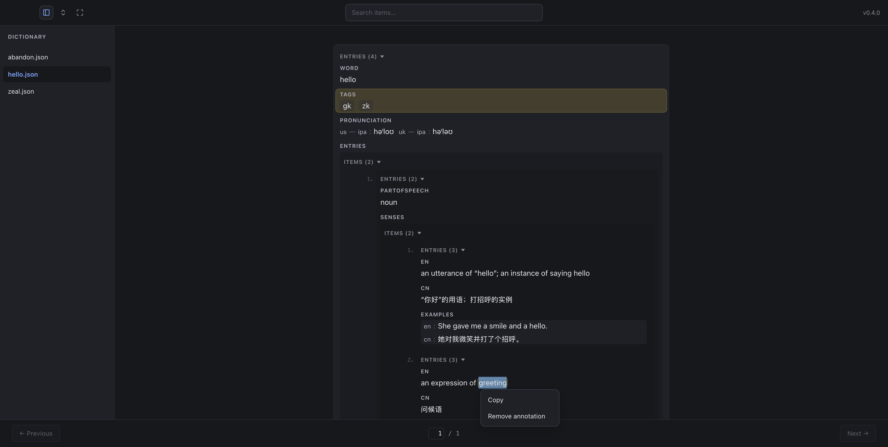
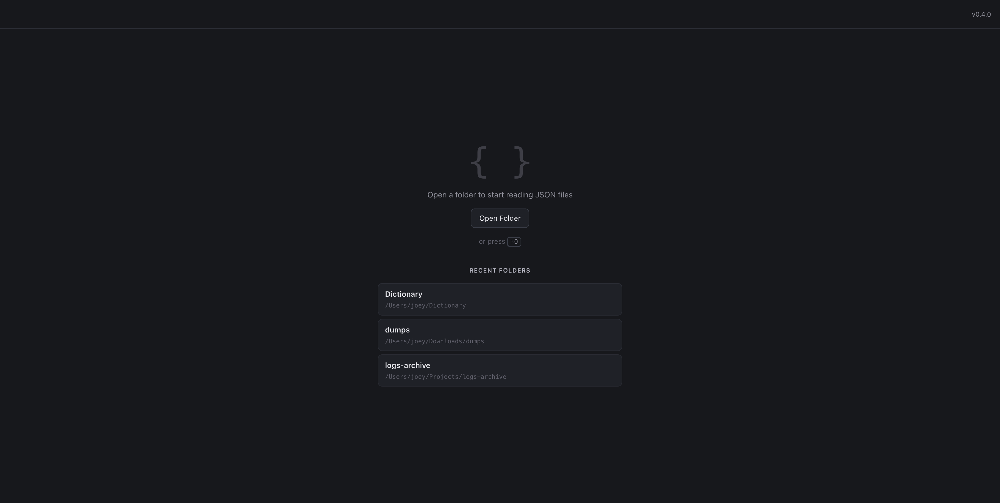

# JSON Reader

[](https://github.com/z1joey/json-reader/actions/workflows/ci.yml)
[](https://github.com/z1joey/json-reader/actions/workflows/release.yml)
[](LICENSE)

A minimal, read-only desktop viewer for JSON files, built for one job: making
large JSON pleasant to read.

Point it at a folder and read. Files whose root is a big array — exports,
dumps, logs, datasets — are shown one item at a time with keyboard paging, so
even multi-gigabyte files open instantly. Every other JSON value is rendered
as a structured, human-readable document.


## Highlights

- **Huge array files, opened instantly.** The file is streamed once through a
  byte-level scan that records only the byte range of each top-level element;
  an element is read and parsed only when you page to it. Navigating never
  re-reads the file, and memory stays flat no matter the file size.
- **Folder reading.** `⌘/Ctrl+O` opens a folder; its top-level `.json` and
  `.md` files are listed in a collapsible sidebar to click through, and
  search finds files too. A folder with a single file behaves like a plain
  file open. Markdown files render as formatted documents (GFM tables, task
  lists, fenced code) with a toggle back to the raw source; markdown-shaped
  string values inside JSON get the same toggle beside the value.
- **Set it as the default viewer.** The app declares `.json` and `.md`
  document types, so after installing you can select a file in Finder,
  choose *Open With → JSON Reader*, and make it the default with
  *Open With → Other → Use this application always*. Double-clicking a file
  then opens it directly in the reader. If the entry doesn't show up right
  away, log out and back in (or run
  `/System/Library/Frameworks/CoreServices.framework/Frameworks/LaunchServices.framework/Support/lsregister -f /Applications/json-reader.app`)
  to refresh Launch Services.
- **Search that ranks.** Case-insensitive search across every JSON file in
  the opened folder, ranked by match quality: exact string values first, then
  value prefixes, then any occurrence. Results show the file, the enclosing
  field, a highlighted snippet, and the item number; picking a result opens
  that file and jumps to that item.
- **Annotations, precise as a selection.** Select any text inside a value,
  right-click, and the menu offers *Copy* and *Annotate*: the exact span is
  recorded in a sidecar `<file>.annotations.json` next to the source — the
  array item, the JSON path, the character range, the line, the byte offset,
  and a raw excerpt of the value. One value can carry several
  non-overlapping marks (an overlapping selection trims the old spans), the
  marked words stay highlighted in the reader, and selecting the same span
  again — or just right-clicking inside it — offers *Remove annotation*.
  *Annotate Error* still flags a whole item or file that fails to load.

  
- **Recent folders.** The initial page lists the three most recently opened
  folders; clicking one reopens it directly, and entries whose folder has
  disappeared drop off the list on their own.

  
- **Fullscreen reading.** The header's expand icon fills the screen with the
  document alone — no sidebar, no header, no pager. The keyboard keeps
  working: `←/→` page items, `↑/↓` scrolls, `Esc` returns.
- **A reader, not an editor.** Leaf-shaped containers — arrays of scalars,
  records of scalars, machine-nested grouping — collapse into a single
  flowing line of pills and `key: value` pairs; structured records read as
  dictionary cards, nested groups sit on quiet tinted panels, and every
  child group starts folded behind a count summary so an item opens as a
  readable outline instead of a wall. A header toggle expands or collapses
  all sections at once, and very long strings are truncated with a
  *Show all* button.
- **Keyboard-first.** Page through items, jump to an item by number, scroll
  the document, and search without leaving the keyboard; files are picked in
  the sidebar or through search.
- **Native and quiet.** Light/dark follows the system setting; the renderer
  is sandboxed with context isolation on and a strict content security
  policy. All file access lives in the main process.

## Download

Grab the latest `json-reader-<version>-arm64.dmg` from the
[Releases page](https://github.com/z1joey/json-reader/releases) (macOS,
Apple Silicon). Prebuilt packages currently cover macOS only; on Intel Macs,
Windows, or Linux, [run it from source](#development) instead.

The build carries an ad-hoc signature and is not notarized, so macOS
Gatekeeper warns on first launch — recent macOS versions may even claim the
app "is damaged". It isn't; the warning only reflects the missing Apple
notarization. After moving the app to `/Applications`, clear the download
quarantine once:

```sh
xattr -cr /Applications/json-reader.app
```

Alternatively, use **Open Anyway** in System Settings → Privacy & Security.

## Keyboard shortcuts

| Key | Action |
| --- | --- |
| `⌘/Ctrl+O` | Open a folder |
| `⌘/Ctrl+F` | Focus search |
| `←` / `→` , `PageUp` / `PageDown` | Previous / next array item |
| `↑` / `↓` | Scroll the document |
| type a number, `Enter` | Jump to that array item |
| `↑` / `↓` , `Enter` , `Esc` | Navigate / pick / dismiss search results |
| `Esc` | Exit fullscreen reading |

## Development

Requires Node.js 22+ and npm.

```sh
npm install
npm run dev      # develop with hot reload
npm run build    # production build into out/
npm start        # launch the built app
npm test         # unit tests
npm run typecheck
```

### Architecture

- **Main process** (`src/main`) — owns all file access. `jsonFile.ts` streams
  a file through a byte-level structural scan: when the root is an array it
  records only the byte range of each top-level element, then parses elements
  individually on demand. Opening a huge file never parses it all, and moving
  between items never re-reads the file.
- **Preload** (`src/preload`) — exposes the renderer-facing calls
  (`openFolder`, `openFile`, `getItem`, `search`, annotations, recent
  folders, `onOpenFolderRequested`, `onFullscreenChanged`) over
  `contextBridge`, with `contextIsolation: true`, `nodeIntegration:
  false`, and `sandbox: true`.
- **Renderer** (`src/renderer`) — React app; renders the current value only,
  along with the reading chrome: the collapsible sidebar, search, the pager,
  the selection context menu, and fullscreen reading mode. Search is
  folder-aware: results can come from any JSON file in the opened folder,
  and selecting a result jumps to that file. Annotations are stored by the
  main process in sidecar files; the renderer only decides what the reader
  selected — the exact value path and character span.
- **Shared** (`src/shared`) — IPC response shapes used by both sides.

### CI and releases

Two GitHub Actions workflows live in `.github/workflows/`; run history is on
the [Actions tab](https://github.com/z1joey/json-reader/actions).

- **CI** (`ci.yml`) — runs on every push to `main` and every pull request:
  installs dependencies, then typechecks, runs the unit tests, and does a
  production build.
- **Release** (`release.yml`) — runs when a `v*` tag is pushed: verifies the
  tag matches the version in `package.json`, re-runs typecheck and tests,
  builds an unsigned macOS (Apple Silicon) `.dmg` with electron-builder, and
  publishes it as a GitHub Release.

The version in `package.json` is the single source of truth. To cut a
release:

1. Bump `version` in `package.json` and commit it.
2. Tag and push: `git tag v0.2.1 && git push origin v0.2.1`.
3. The Release workflow attaches `json-reader-0.2.1-arm64.dmg` to a GitHub
   Release with generated notes.

Re-releasing the same version requires deleting both the GitHub Release and
its tag first.

## Contributing

Issues and pull requests are welcome. Keep the app small and focused: it is a
reader, not an editor. A pull request should pass `npm run typecheck`,
`npm test`, and `npm run build`.

## License

[MIT](LICENSE) © Joey Zhang
